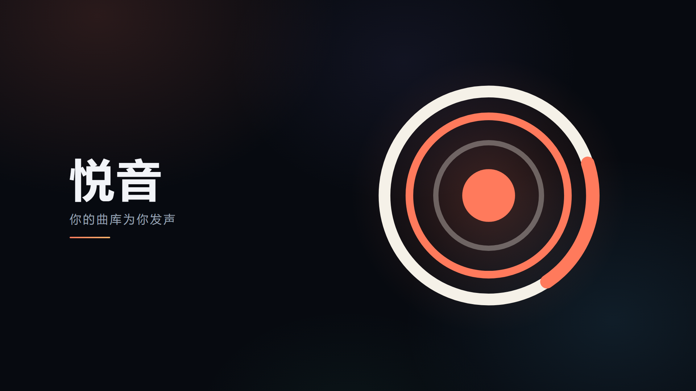
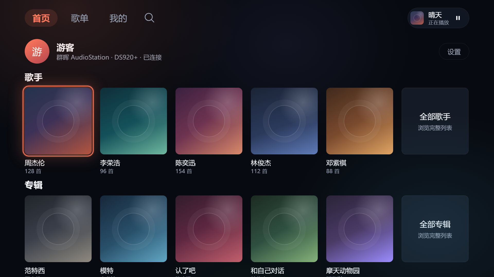
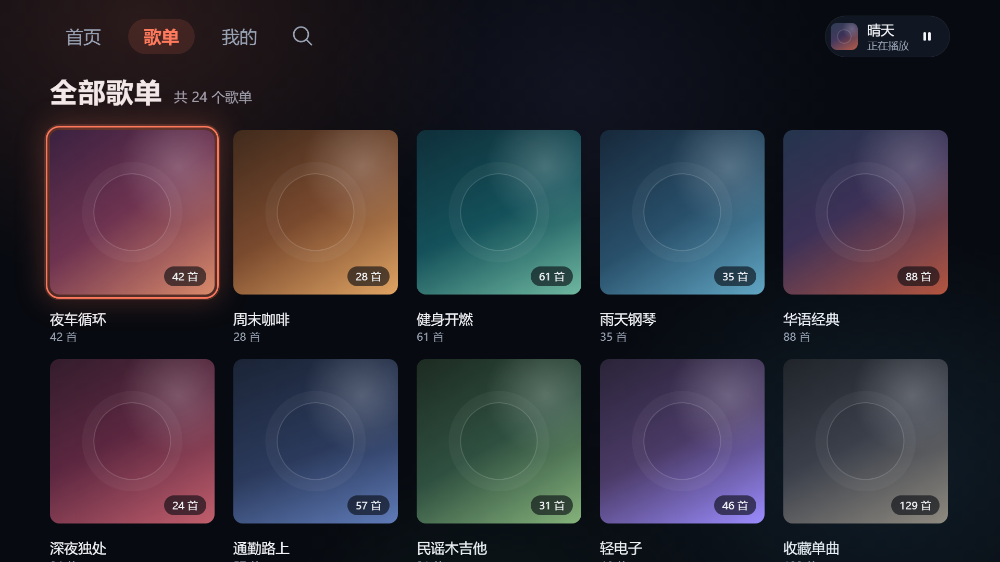
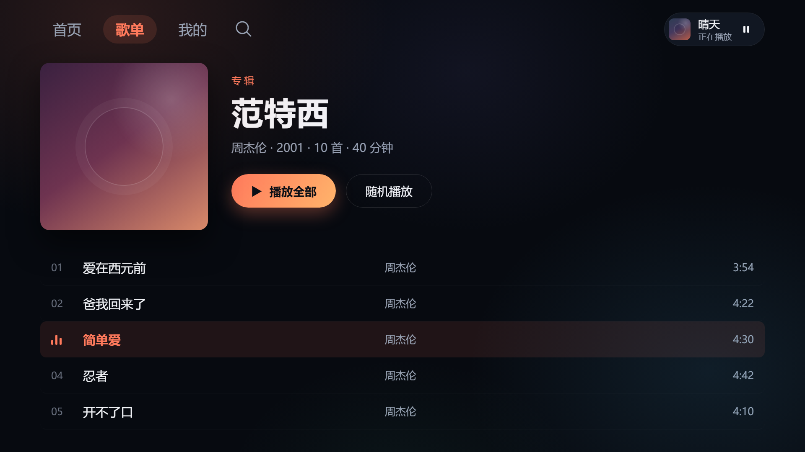
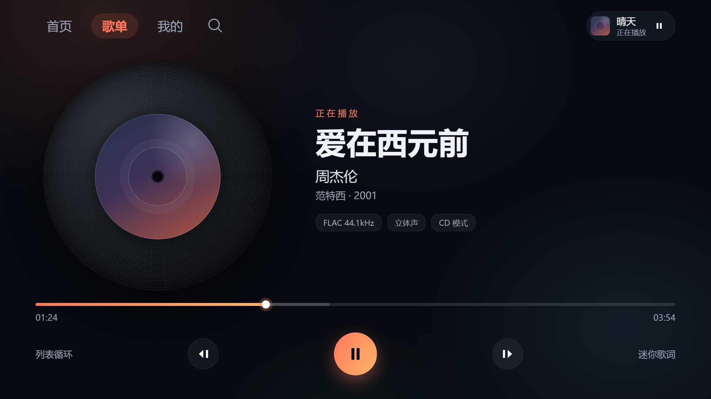
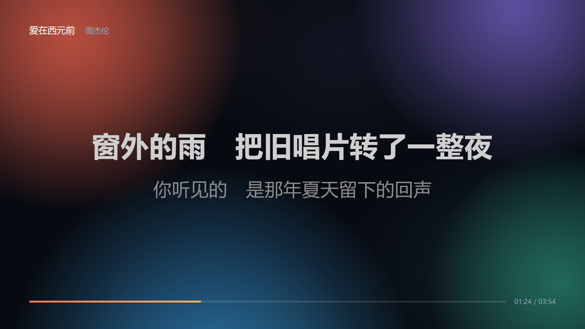
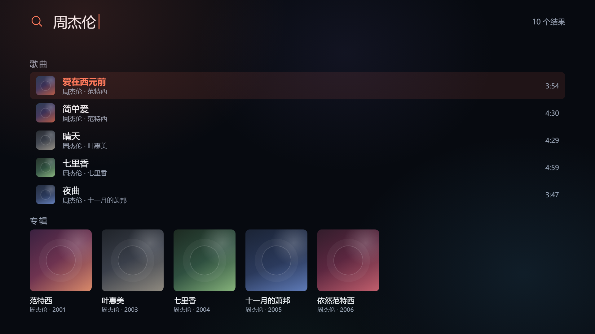

<p align="center">
  
</p>

<h1 align="center">悦音</h1>

<p align="center">给电视做的自托管音乐客户端</p>

<p align="center">
  
  
  
</p>

---

## 这是什么

悦音是一个 **Android TV 音乐客户端**。它本身不提供任何音乐内容，只负责把你自己的音乐服务器上的曲库，用适合大屏和遥控器的方式呈现出来。

装好、填上自己服务器的地址，就能在客厅电视上听 NAS 里的音乐。

## 界面

<p align="center">
  
  
</p>
<p align="center">
  
  
</p>
<p align="center">
  
  
</p>
<p align="center">
  
</p>

<p align="center"><sub>截图中的歌手、专辑与歌曲均为演示数据</sub></p>

## 支持的数据源

| 平台 | 登录需要填 |
| --- | --- |
| 飞牛 fnOS | 服务器地址 + 账号密码 |
| Emby / Jellyfin | 服务器地址 + 账号密码 |
| Plex | 服务器地址 + Token |
| Navidrome / Subsonic / Airsonic | 服务器地址 + 账号密码 |
| 群晖 AudioStation | 服务器地址 + DSM 账号密码（需有 AudioStation 权限） |
| WebDAV / Alist | 地址（含路径）+ 账号密码 |
| SMB 共享 | `smb://IP/共享名/目录` + 账号 |

所有平台共用同一套界面、搜索、播放与歌单，换平台不用重装。

## 功能

**用遥控器就能操作**

- 导航、宫格、列表全部为遥控器设计，焦点到哪里一目了然
- 顶部切换页签时，焦点落上去就直接跳转，不用再按确定
- 播放页沉浸态：`←` 快退 10 秒，连按两次上一曲，长按连续快退；`→` 同理快进 / 下一曲；`确定` 播放暂停；`↑` `↓` 唤出控制栏
- 遥控器上的播放 / 上一曲 / 下一曲按键始终有效

**播放**

- 三种播放页样式：CD 模式、大海报模式、迷你歌词
- 迷你歌词会把当前句和下一句一起显示，跟着节奏缓慢浮动，长句自动缩小以免被切掉
- 进度条能看到已缓冲范围，歌词随播放逐行高亮

**搜索**

- 边输边搜，支持拼音首字母（输入 `zjl` 也能找到「周杰伦」）

**外观**

- 启动时是一枚缓缓转动的黑胶唱片，随后唱片转起、声波扩散，首页浮现
- 从 1080p 到 4K、从小屏到大屏，界面比例与字号保持一致

## 安装

**直接下载**：到 [Releases](../../releases) 下载最新的 universal APK，拷到电视上用文件管理器装上即可。

- 最低 Android 6.0，推荐 Android TV 9 及以上
- universal 包已包含 `arm64-v8a / armeabi-v7a / x86 / x86_64`，不用挑架构

**自己构建**（需要 JDK 21 与 Android SDK platform 36）：

```bash
./gradlew :app:assembleStoreRelease
```

正式安装包需要自备签名证书。**本仓库不包含任何签名私钥。**

## 首次使用

1. 打开 App，直接进首页，不需要注册任何账号
2. 首页点「新增平台」，选你的音乐服务器类型
3. 按提示填地址和账号（Plex 填的是 Token，不是密码）
4. 连上后曲库会自动加载

**Plex Token 获取**：Plex 网页版随意打开一首歌 → 右键「获取信息」→「查看 XML」→ 地址栏里 `X-Plex-Token=` 后面那串就是。

## 已知限制

- **飞牛远程登录（FNID）不可用**。请填局域网 IP，或能直接访问的域名。
- **WebDAV / SMB 的歌曲信息来自目录和文件名**，元数据不如媒体服务器完整；封面取同目录下的图片文件。
- **Plex 需要手动填 Token**，暂不支持电视上显示配对码、手机确认的授权方式。
- **SMB / WebDAV 播放**个别文件可能没声音，兼容性还在完善。
- 只在有限的几台设备上验证过，其他机型可能有布局或解码差异。

## 项目来源与致谢

本项目**不是从零写的**，它站在两个开源项目的基础上：

### 鸣谢

1. **[QiaoKes/fn-music-tv](https://github.com/QiaoKes/fn-music-tv)** —— 本项目的**代码基础**。飞牛音乐 TV 客户端的原创实现，整体架构、数据层与播放链路都源自这里。没有这个项目就没有悦音。
2. **[amcfy-music/amcfy-music](https://github.com/amcfy-music/amcfy-music)** —— 本项目的**多平台接入与界面设计的参考**。「一套界面适配多个音乐服务」的思路，以及大屏网格、播放页样式等视觉方向，都从这里获得了重要启发。

上游代码沿革：`QiaoKes/fn-music-tv`（原始项目）→ `liangleionline/fn-music-tv`（飞牛音乐 TV 增强版，本项目的直接代码基线）→ 本项目。感谢每一位上游作者的付出。

如果这两个项目对你有帮助，请去给原作者点 Star。

### 第三方依赖

Jetpack Compose、Media3、OkHttp、Coil、pinyin4j、jcifs-ng、BouncyCastle 等，完整清单见各模块 `build.gradle.kts`。

## 免责声明

- 本项目是**第三方客户端**，与飞牛 fnOS、Emby、Jellyfin、Plex、群晖 Synology、Alist 等任何官方**均无关联**，未获得其授权、认可或支持。文中出现的产品名称与商标归各自所有者。
- 本项目**不提供、不托管、不分发任何音乐内容**，也不内置任何内容源。它只是一个访问你自己服务器的客户端。
- 请仅用于访问**你本人拥有或已获授权**的媒体内容与服务器，并遵守所连接服务的服务条款。**不得**用于传播侵权内容或任何违法用途。
- 本软件按「现状」（AS IS）提供，**不附带任何明示或暗示的担保**，包括但不限于适销性、特定用途适用性与不侵权担保。
- 使用本软件的一切风险由使用者自行承担。因使用或无法使用本软件造成的任何直接或间接损失（数据丢失、服务中断、账号被封、设备损坏、法律纠纷等），作者与贡献者**不承担任何责任**。
- 请遵守你所在地区的法律法规。若你不同意上述任何一条，请立即停止使用并删除本软件。

## 许可证

[GPL-3.0](LICENSE)。作为 GPL-3.0 项目的衍生作品，本项目同样以 GPL-3.0 发布；二次分发请保留同样的许可与来源说明。
